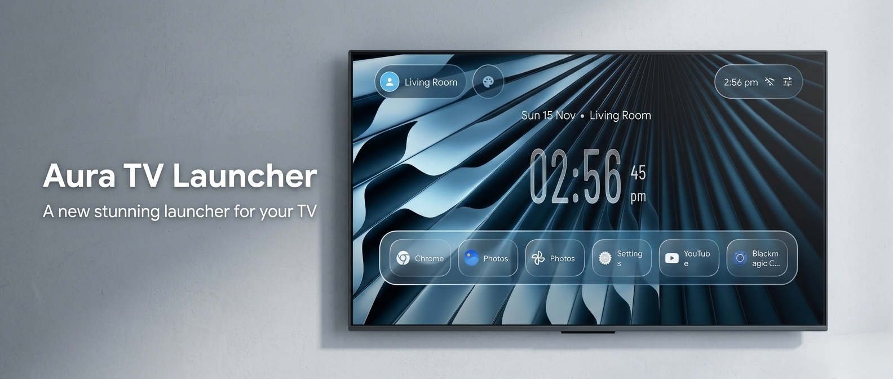
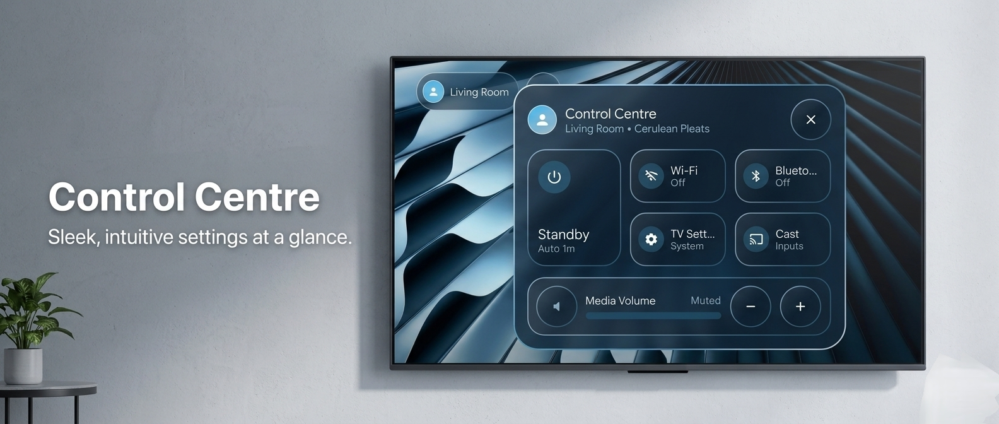
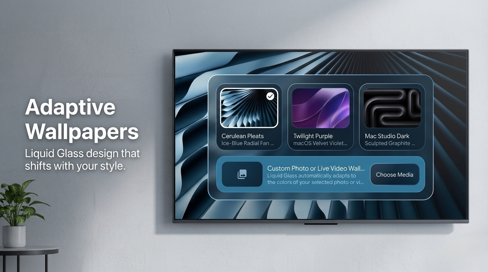

# 📺 Aura TV Launcher

**Aura TV** is a smooth, modern, and lightweight launcher built for Android TV devices. Designed around a signature **liquid glass** aesthetic, it replaces cluttered stock interfaces with translucent panels, fluid animations, and instant access to your favorite apps and system controls.

## ✨ Features

* **Liquid Glass UI:** Translucent, frosted-glass overlays and app cards that dynamically blend with your active wallpaper.
* **Custom Control Centre:** An all-in-one quick-settings panel giving you instant access to:
  * Wi-Fi & Bluetooth toggles
  * Media volume slider with quick mute
  * Input / Cast switching & TV System Settings
  * Quick Standby timer (e.g., Auto 1m)
  * On-the-fly theme and profile switching
* **Personalization & Themes:** Customize your setup with curated wallpapers (like *Cerulean Pleats*), light/dark theme modes, and custom room or device profiles (e.g., *Living Room*, *Y Series*).
* **Ambient Standby Screen:** A minimalist screensaver/standby view displaying a large digital clock, date, Wi-Fi status, and active theme—waking up instantly with any remote keypress.
* **Clean App Dock:** A streamlined bottom dock for quick, lag-free navigation across streaming apps (Netflix, Prime Video, YouTube)
 browsers, and system utilities.

## 📷 Screenshots

<!-- Line 22: Replace with your first uploaded file (Main UI) -->

<!-- Line 26: Replace with your second uploaded file (Control Centre) -->

<!-- Line 27: Replace with your third uploaded file (Wallpapers) -->

## 🚀 Installation

1. Download the latest `.apk` from the [Releases](../../releases) page.
2. Sideload the APK onto your Android TV / Google TV device via ADB or a file manager.
3. Press the **Home** button on your remote and select **Aura TV** as your default launcher.

## 🛠️ Built With

* **Platform:** Android TV / Google TV
* **UI Design:** Custom Translucent / Glassmorphism Components

## 🤝 Contributing

Contributions, issues, and feature requests are welcome!

## Insta Page

Don't forget to follow me at instagram
@razer_bionic
